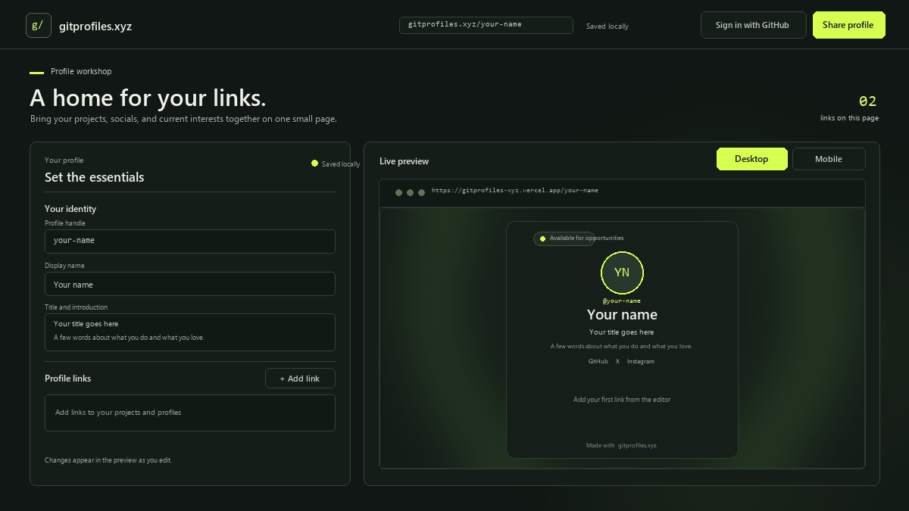

# gitprofiles.xyz

GitHub profilindeki projeleri, sosyal hesapları ve diğer bağlantıları tek bir kişisel sayfada birleştir. gitprofiles.xyz; canlı önizlemesi olan bir profil düzenleyicisi, yayınlanabilir kişisel sayfalar ve GitHub README'lerinde kullanılabilen görsel kartlar sunar.

<p align="center">
  
</p>

<p align="center">
  <a href="https://gitprofiles-xyz.vercel.app">Canlı demoyu aç</a>
  &nbsp;·&nbsp;
  <a href="https://github.com/tugraeker/gitprofiles.xyz">Kaynak kodu incele</a>
</p>

## Proje ne yapıyor?

Sol taraftaki stüdyoda profilini düzenlerken sağ tarafta yayımlanacak sayfayı anında görürsün. Sayfana bir kullanıcı adı seçebilir, kısa bir tanıtım ekleyebilir, sosyal hesaplarını ve özel bağlantılarını sıralayabilir; arka planını renk, görsel veya video ile kişiselleştirebilirsin. Yayınlanan profil `https://gitprofiles-xyz.vercel.app/kullaniciadi` benzeri kısa bir adreste açılır.

Bu proje yalnızca README metni üretmez: önceliği herkese açık mikro profil sayfasıdır. Paylaşım penceresi ayrıca profil kartını SVG olarak indirir ve aynı kartı GitHub README'sine yerleştirmek için Markdown ya da HTML kodu verir.

## Öne çıkanlar

- **Anlık düzenleme:** İsim, unvan, bio, avatar, konum, tema ve bağlantı değişiklikleri canlı önizlemeye yansır.
- **Özel profil adresi:** Uygun bir kullanıcı adıyla profilini `/<kullaniciadi>` rotasında yayımla.
- **Bağlantılar ve sosyal hesaplar:** Özel link kartları ile GitHub, X, Instagram ve Discord hesaplarını ekle; profildeki sıralamayı düzenle.
- **Görünüm ayarları:** Koyu ve açık stüdyo teması, profil renkleri ve gradyanı, özel arka plan görseli ya da video kullan.
- **Medya:** Avatar ve görsel yükle; MP4/WebM arka planları görünür olduğunda yükleyip oynat. Yüklenen görseller WebP'ye dönüştürülür.
- **Mobil ve masaüstü önizlemesi:** Küçük ekranda düzenleme ve önizleme sekmeleriyle sayfanın farklı ekranlardaki görünümünü kontrol et.
- **GitHub vitrini:** Kullanıcı adından herkese açık, fork olmayan depoları ve birincil dillerini al; varsa `kullaniciadi/kullaniciadi` profil README'sini göster.
- **README kartı:** Profil fotoğrafı ve bağlantıları içeren SVG kartı önizle; GitHub için Markdown veya HTML yerleştirme kodunu kopyala ya da SVG'yi indir.
- **Web ve masaüstü:** Vercel'de web uygulaması olarak çalışır; Electron ile Windows, macOS ve Linux masaüstü paketleri hazırlanabilir.
- **İsteğe bağlı Rust modülü:** N-API üzerinden profil doğrulama çekirdeği eklenebilir; web uygulamasını çalıştırmak için gerekli değildir.

## GitHub verisi ve profil paylaşımı

GitHub vitrini, yazılan kullanıcı adının en fazla 100 herkese açık sahibine ait deposunu GitHub REST API üzerinden okur; depoların birincil dil dağılımını gösterir ve profil deposunda `README.md` bulunuyorsa içeriğini açılabilir bir bölümde sunar. Bu görünüm hesabın tüm dil kullanımını bayt bazında ölçmez; depolarda tanımlı birincil dilleri sayar.

Profil düzenleyicisi GitHub OAuth ile açılır. Supabase bağlantısı olmadan yerel önizleme ve taslak paylaşım adresi kullanılabilir; kalıcı kullanıcı adı, herkese açık profil ve medya saklama için Supabase ayarlarının yapılması gerekir. `Save / Share Profile` penceresi profil bağlantısını, önizlenen SVG kartı ve README'ye yapıştırılacak kodu birlikte sunar.

## Mimari

```text
Web / Electron
      │
      ├── React + TypeScript profil stüdyosu ── canlı profil önizlemesi
      ├── GitHub REST API ── herkese açık depolar, diller ve profil README'si
      ├── Supabase Auth / Postgres / Storage ── oturum, profil ve medya
      └── Vercel API ── paylaşım kartı SVG'si ve profil yayınlama aktarımı
```

### Proje yapısı

```text
api/
  profile-card.ts          Paylaşılabilir SVG profil kartı
  publish-profile.ts       Profil yayınlama API'si
electron/
  main.cjs                 Güvenli masaüstü penceresi ve auth deep link
  preload.cjs              Renderer için sınırlı, doğrulanmış API
native/                    Opsiyonel Rust/N-API modülü
src/
  App.tsx                  Düzenleyici, önizleme ve paylaşım akışı
  model.ts                 Profil ve tema veri tipleri
  lib/profile-service.ts   GitHub OAuth, profil ve medya işlemleri
  lib/share.ts             Profil kartı, Markdown ve HTML çıktısı
  styles.css               Stüdyo ve profil stilleri
supabase/migrations/       Profil tablosu, RLS ve medya bucket'ı
docs/
  profile-studio-demo.gif  Stüdyo ve paylaşım akışı
```

## Yerel geliştirme

Node.js ve npm kurulu olmalı. Ardından:

```sh
git clone https://github.com/tugraeker/gitprofiles.xyz.git
cd gitprofiles.xyz
npm install
```

Stüdyoyu web olarak çalıştır:

```sh
npm run web
```

Vite ile birlikte Electron masaüstü penceresini aç:

```sh
npm run dev
```

Supabase olmadan düzenleyicinin yerel önizlemesi ve taslak paylaşımı kullanılabilir. GitHub ile oturum açma, kalıcı profil yayınlama ve medya yükleme için aşağıdaki Supabase adımlarını tamamlayıp geliştirme sunucusunu yeniden başlat.

## GitHub OAuth ve Supabase

1. Supabase'te bir proje aç ve `supabase/migrations/20261103000000_profiles.sql` dosyasını SQL Editor üzerinden bir kez çalıştır. Migrasyon profil tablosu ve erişim politikalarını, ayrıca `profile-media` Storage bucket'ını oluşturur.
2. GitHub Developer Settings'ten bir OAuth App oluştur. OAuth App'in **Authorization callback URL** değeri Supabase projenin `https://<project-ref>.supabase.co/auth/v1/callback` adresi olmalı.
3. Supabase Dashboard'da **Authentication → Providers → GitHub** bölümünde GitHub Client ID ve Client Secret değerlerini kaydet.
4. Supabase **Authentication → URL Configuration** ayarlarında Site URL'yi kendi dağıtım adresine ayarla. Redirect URL listesine kullandığın adresleri ekle:

   ```text
   https://gitprofiles-xyz.vercel.app/auth/callback
   https://gitprofiles.xyz/auth/callback
   http://localhost:5173/auth/callback
   http://127.0.0.1:5173/auth/callback
   gitprofiles://auth/callback
   ```

   Kendi dağıtımında yalnızca gerçekten kullandığın üretim adresini bırak. `gitprofiles.xyz` özel domain'i bağlı değilse Vercel adresini kullan.

5. `.env.example` dosyasını `.env.local` adıyla kopyala ve Supabase proje URL'si ile public/anon anahtarını gir:

   ```dotenv
   VITE_SUPABASE_URL=https://<project-ref>.supabase.co
   VITE_SUPABASE_ANON_KEY=<public-anon-key>
   VITE_PUBLIC_URL=
   ```

`VITE_PUBLIC_URL` yerelde boş kalabilir; uygulama geçerli origin'i kullanır. Özel domain ya da sabit üretim adresi kullanıyorsan tam origin'i (`https://...`) yaz. OAuth Client Secret'ı bu dosyaya, Vercel değişkenlerine veya repoya koyma; secret yalnızca Supabase GitHub sağlayıcısı ayarında tutulur. `.env.local` Git tarafından yok sayılır.

## Vercel dağıtımı

Repo Vercel'e bağlıysa her push yeni dağıtım başlatır. Proje derleme komutu `npm run build:web`, çıktı klasörü `dist` olarak `vercel.json` içinde tanımlıdır. Vercel proje ayarlarında aşağıdaki ortam değişkenlerini **Production** ve geliştirme ortamlarında ihtiyacına göre ekle:

```text
VITE_SUPABASE_URL
VITE_SUPABASE_ANON_KEY
VITE_PUBLIC_URL (isteğe bağlı)
```

Ardından Supabase Site URL ve izinli yönlendirme adreslerini dağıtım adresinle eşleştir. Her yeni Vercel preview URL'sini OAuth yönlendirme listesine eklemek gerekmez; düzenli kullandığın production ve local adresler yeterlidir.

## Komutlar

| Komut | Kullanım |
| --- | --- |
| `npm run web` | Yerel Vite web sunucusu |
| `npm run dev` | Vite ve Electron geliştirme penceresi |
| `npm run typecheck` | TypeScript denetimi |
| `npm test` | Vitest testleri |
| `npm run build:web` | Web için tip denetimi, test ve Vite derlemesi |
| `npm run build` | Masaüstü varlık yollarıyla tip denetimi, test ve Vite derlemesi |
| `npm run native:build` | Rust/N-API modülünü mevcut hedef için derle |
| `npm run dist` | Yerel native modülü ve Electron masaüstü paketini üret |

Web derlemesini yerelde doğrulamak için:

```sh
npm run build:web
```

`npm run native:build` için Rust toolchain gerekir. Native ikililer işletim sistemi ve mimariye bağlı olduğundan her masaüstü hedefinde ayrı derlenip sınanmalıdır.

## Güvenlik ve veri

- Tarayıcıya yalnızca Supabase URL'si ve public/anon anahtarı verilir; service-role anahtarı veya OAuth Client Secret istemci koduna eklenmez.
- Profil verileri Postgres Row Level Security ile korunur. Herkes yalnızca yayınlanmış profili okuyabilir; yazma işlemleri oturum açmış profil sahibine aittir.
- Profil medyası CDN üzerinden herkese açık okunur; yükleme, güncelleme ve silme işlemleri kullanıcının kendi Storage klasörüyle sınırlandırılır. Bucket görsel ve video dosyaları için 40 MB üst sınırı kullanır.
- Electron penceresinde Node entegrasyonu kapalı, context isolation ve sandbox açıktır. Renderer'a yalnızca preload üzerinden sınırlı işlevler açılır.
- Profil herkese açık bir sayfa ve kart üretir; kişisel ya da gizli bilgileri profile ekleme.

## Katkı

Geliştirme öncesi `npm run typecheck`, `npm test` ve `npm run build:web` komutlarını çalıştır. Arayüz veya profil verisi değişikliklerinde web önizlemesini ve mobil görünümü de kontrol et.
